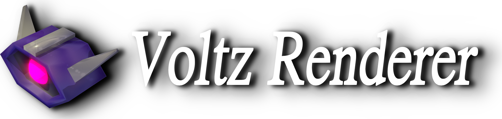

#  
**GUI-less Rendering for Blender**, 0.22 Alpha Release.
 

_Does Have_

-Saving of Directory of Blender Location and Output Folder,  
-Rendering for Image and Animation,  
-Rendering to Specific Output Folder,  
-Rendering at Specific frame,  
-Changing of CPU/GPU Devices,  
-And Cool Gui!!  

_Doesn't Have_

-Changing of Render Engine,  
-Rendering Specific Scene inside of .blend File,  
-Rendering a list of blender files.  

(_If you are having problems with path directories, please delete settings.json and restart Voltz.py, then make sure to select the correct directories_)
